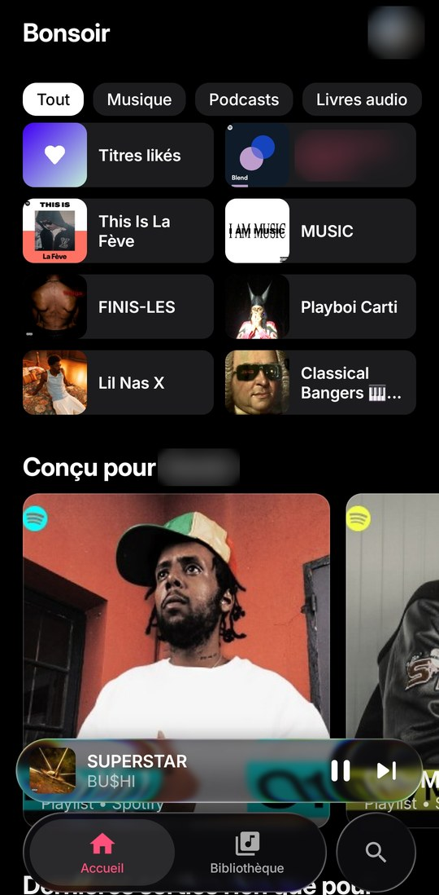
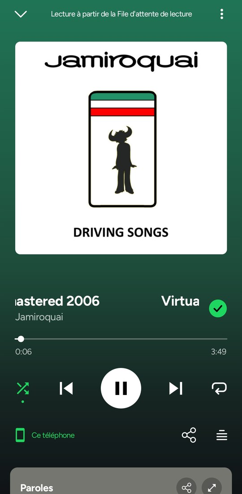
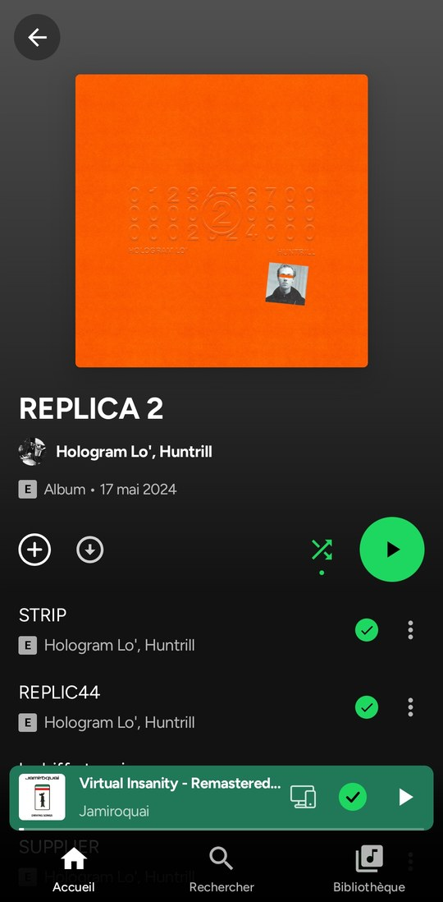

# Orpheon

*Formerly Myspoti. The community chose the new name; version 1.0.0 is the first under it. The icon is a placeholder until the real one is made.*

*Coming from Myspoti? Update it to 2.4.1: it offers to install Orpheon, a new app next to it. Betas are on the [releases page](https://github.com/kota-zo/myspoti/releases).*

[](https://github.com/kota-zo/Orpheon/releases/tag/v1.0.0)
[](LICENSE)
[](https://discord.gg/jXKnGVFnGS)

**An extension-based music player for Android, Android TV and Wear OS.** The sound comes from your own files, Live Radio, or the extensions you choose to install; songs, albums and artists are described by public catalogs (Deezer, iTunes, MusicBrainz).

> [!NOTE]
> Orpheon hosts no content and ships no audio or download source. Extensions are made and published by third parties, and installing one is your choice: you are responsible for the sources you use, and for having the right to use them. Orpheon does not condone piracy, and is not affiliated with any streaming service or content provider.

<p align="center">
  
</p>

<p align="center">
  <a href="https://github.com/kota-zo/Orpheon/releases/tag/v1.0.0"><b>⬇ Download Orpheon 1.0.0</b></a>
</p>

<p align="center"><sub>The Immersive look comes from <a href="https://github.com/kushagrasinghx/BitChord">BitChord</a>: see <a href="#bitchord">Credits</a>.</sub></p>

<p align="center">
  <a href="https://ko-fi.com/myspoti"></a>
  <a href="https://github.com/sponsors/kota-zo"></a>
</p>

## Why Orpheon

### 🧩 Built on extensions
Orpheon is a player first. Lyrics, sound and downloads can come from extensions: small scripts, written by other people, that run in a sandbox and only do what they asked for when you installed them. You pick them, you order them, you turn them off. Orpheon has no source of its own; an extension's files come from where its author says, and Orpheon keeps them encrypted on your phone.

### 🎧 Your music, your way
Search, albums and artists from public catalogs, your files, Live Radio and Android Auto, in Orpheon's own Classic and Immersive looks, plus **word-by-word lyrics**, **song meanings from Genius** and AutoMix.

## What is it?

Orpheon is a music player for Android that you install yourself. It needs no account: it plays the files on your phone, Live Radio, and what the extensions you install bring. Songs found in a search are described by public catalogs (Deezer, iTunes, MusicBrainz) and play from your audio-source extensions; a song that no source has is not played.

## Get started

1. Download the APK from the [Orpheon 1.0.0 release](https://github.com/kota-zo/Orpheon/releases/tag/v1.0.0) and open it (Android 10 or later). Android asks once to allow installs from your browser or file manager.
2. Tap **Get started**, and choose a music account or none.
3. Pick the sound quality, allow what you want (notifications, Bluetooth, local files…), and you are in.

New versions are offered inside the app: one tap downloads and installs them.

Each release carries four APKs:
- `Orpheon-<version>-ARMv8.apk`: almost every phone from the last ten years (64-bit). When in doubt, take this one.
- `Orpheon-<version>-ARMv7.apk`: older or entry-level 32-bit phones (an app such as CPU-Z or Device Info shows which one yours is; if ARMv8 refuses to install, take this one).
- `Orpheon-<version>-universal.apk`: both in one, larger.
- `Orpheon-<version>-TV.apk`: Android TV and Google TV (the same app; on a TV it opens its TV screens).

Betas are `Orpheon-Beta-<version>-...`. The in-app update picks the right one by itself.

Orpheon is a new app next to Myspoti 2.4 and earlier (`app.myspoti`, `app.myspoti.stable`): Myspoti's update button opens this page instead of installing it, as Android cannot install one app over the other. Install Orpheon, then uninstall Myspoti when you no longer need it.

Obtainium (add `https://github.com/kota-zo/myspoti`; the stable app and the beta app are two apps):
- **Stable** (`app.orpheon`): leave "Include prereleases" off and set the APK filter to `^Orpheon-[0-9].*-ARMv8\.apk$` (or `-ARMv7`, `-TV`).
- **Beta** (`app.orpheon.beta`): turn "Include prereleases" on and set the APK filter to `^Orpheon-Beta-.*-ARMv8\.apk$` (or `-ARMv7`, `-TV`).
- Betas are named `<next version>-beta.<n>` (`1.0.1-beta.1`, then `1.0.1-beta.2`...), marked prerelease on GitHub, and always newer than the last stable.

## What you get

**Listening**
- Search, artist and album pages from public catalogs (Deezer, iTunes, MusicBrainz, in the order you choose in Settings).
- Pick any song: shuffle (Orpheon's own plays every song once before any repeats), the queue (drag to reorder), repeat (all, the song for good, the song once), crossfade, AutoMix, sleep timer.
- A 10-band **equalizer** with presets, playback speed and skip silence; **Stats for nerds** shows the codec, sample rate, bit depth, bitrate and output of what plays.
- Bluetooth with your headphones' name, lock screen, notification, widget and Android Auto.

**Lyrics**
- Synced lyrics, word by word when a source has the timing (or line by line, your choice in Settings), with translation.
- **Song meanings from Genius**: a light bulb for the story of the song, and a long press on an underlined line for its explanation, translated into your language.

**Offline**
- With a download-source extension you installed: keep songs, albums and playlists on the phone, in the formats the extension offers (or re-encoded to small AAC on the phone).
- Downloads are encrypted and stay in Orpheon. A downloaded list follows the list's changes.
- Your local audio files too.

**Extensions**
- Scripts written by other people, in a sandbox: lyrics from other sources, where a song's audio or download comes from, Home sections, menu entries.
- Installing shows what an extension will do (each action with its author's reason, the critical ones marked) and asks for one tick: you install it on your own responsibility. An extension gets every action it lists, or is not installed; an update that asks for more waits for your OK and shows only what changes.
- An audio-source extension plays songs from a service or a server you have access to; a song none has is not played. Use only sources you have the right to use.
- An extension can bring its own settings to Settings, Playback or Downloads (its quality, per network if it likes): the first source of the order shows its own.
- New to extensions? [The user guide](docs/extensions/GUIDE.md): the kinds, installing one, the order of the sources, and what to do when one does not work (Android Auto and Android TV too).
- For authors: [the extensions API](docs/extensions/API.md), and a desktop runner to test without a phone.

**And also**
- Your recap: your top songs, artists and albums, kept on your phone.
- **Live Radio**, off until you turn it on (Settings, Playback): internet radio from the free [Radio Browser](https://www.radio-browser.info) directory, https streams only, favorites kept on your phone. Searches go to Radio Browser, and each station's logo and stream come from that station's own server.
- 69 languages and regional variants, following the phone or picked by hand.
- Data saver, battery saver, AMOLED black, accent colour.

## Screenshots

Two looks, switched in Settings, Display.

**Immersive**

| Home | Player |
|:---:|:---:|
|  |  |

**Classic**

| Home | Player | Artist | Album |
|:---:|:---:|:---:|:---:|
|  |  |  |  |

## Questions

**Where does the music come from?** From your own files, Live Radio, or an extension you installed. Orpheon ships no source: an extension's sound or files come from where its author says, under that author's responsibility and yours.

**What leaves my phone?** Searches and the pages they lead to are read from public catalogs (Deezer, iTunes, MusicBrainz). Lyrics are looked up on lyrics sites, song meanings on Genius, translations on Google Translate, and downloads on the hosts your download-source extension names (shown before you install it). Live Radio, once turned on, searches [Radio Browser](https://www.radio-browser.info) and loads each station's logo and stream from that station's own server. Nothing is sent to the developer.

## Not included

- No DRM circumvention: Orpheon decrypts nothing for an extension.
- No audio or download source of its own, and no content hosted.
- No ad blocking, muting or skipping.

## Disclaimer

The developer is not liable for any misuse of Orpheon or of the extensions people install in it, and is not affiliated with any streaming service or content provider. Use only sources you have the right to use. If you can, support artists by subscribing to the services you listen on, or by buying their music.

## Support

Orpheon is free and made in my spare time. If you enjoy it, you can support it on [Ko-fi](https://ko-fi.com/myspoti) or [GitHub Sponsors](https://github.com/sponsors/kota-zo), also from **About** in the app. Nothing is locked behind a donation.

News, help and ideas: the [Discord server](https://discord.gg/jXKnGVFnGS). Bugs and requests: [GitHub issues](https://github.com/kota-zo/myspoti/issues).

## For developers

The Android project is in `base/`, in these Gradle modules:

- **`:api`** is the contract the UI talks to: plain Kotlin models and interfaces (player, search, catalog, library, playlists, home, lyrics). Its base, `NeutralApi`, talks to no service at all.
- **`:catalog`** answers searches and item pages from public metadata providers (Deezer, iTunes, MusicBrainz, and downloadable provider scripts).
- **`:api-ytmusic`** and **`:api-web`**: the optional YouTube Music account.
- **`:host-android`** is the playback service (media session, notification, Android Auto browsing) and the app's Android-only pieces (logbook).
- **`:extensions`** is the sandbox third-party scripts run in (manifest, permissions, catalogue), plain JVM: an extension runs the same on a desktop. **`:extensions-cli`** is that desktop runner.
- **`:automix`**, **`:pass`** (moving settings to another device) and **`:wear`** (Wear OS).
- **`:app`** is the Compose UI, in its Classic and Immersive looks.

Requirements: JDK 17+ and the Android SDK (compileSdk 37).

```bash
cd base
./gradlew assembleDebug
./gradlew testDebugUnitTest
```

Every push builds and tests on GitHub Actions. A `vX.Y.Z` tag publishes a stable APK in Releases and a `vX.Y.Z-beta.N` tag a beta one (a prerelease, `tools/check_tag.py` checks the number).

## Credits

### BitChord

Orpheon owes a lot to [BitChord](https://github.com/kushagrasinghx/BitChord) by kushagrasinghx and its contributors (GPL-3.0-or-later), in code:
- **The Immersive look** is ported from it: the player and its mesh backdrop, the swept word-by-word lyrics, the queue panel, the glass tab bar, the top bars, the sheets, the motion and the Home, Search, Library, artist, album, playlist, profile and podcast pages.
- **The equalizer** of the songs the app plays itself: its filters and the way a change glides.

Every file taken from BitChord keeps its GPL-3.0-or-later header and names the BitChord file it comes from; the full list is in [`THIRD_PARTY_NOTICES.md`](THIRD_PARTY_NOTICES.md#bitchord--gpl-30-or-later). Thank you, BitChord.

### Others

- UI derived from [Spotui](https://github.com/Spotui/Spotui) / [Metrolist](https://github.com/MetrolistGroup/Metrolist) (GPL-3.0); Spotui also gave the DASH-to-FLAC remux.
- [NewPipeExtractor](https://github.com/TeamNewPipe/NewPipeExtractor) (GPL-3.0): music videos.
- [Reorderable](https://github.com/Calvin-LL/Reorderable) (Apache-2.0): dragging the rows of the queue.
- Lyrics: [LRCLIB](https://lrclib.net), LyricsPlus, lrc.red, Kugou and NetEase; song meanings: [Genius](https://genius.com).
- [Material Icons](https://github.com/google/material-design-icons) (Apache 2.0) and the [Manrope](https://github.com/googlefonts/manrope) font (SIL OFL 1.1, see `base/licenses/`).

Full notices: [`THIRD_PARTY_NOTICES.md`](THIRD_PARTY_NOTICES.md).

## License

GPL-3.0. If you reuse this code, you must credit Orpheon, keep the license notices and
publish your complete source under GPL-3.0. Closed-source or uncredited copies are
violations and will be reported to the hosting platform (DMCA takedown). See also
[`AGENTS.md`](AGENTS.md).
