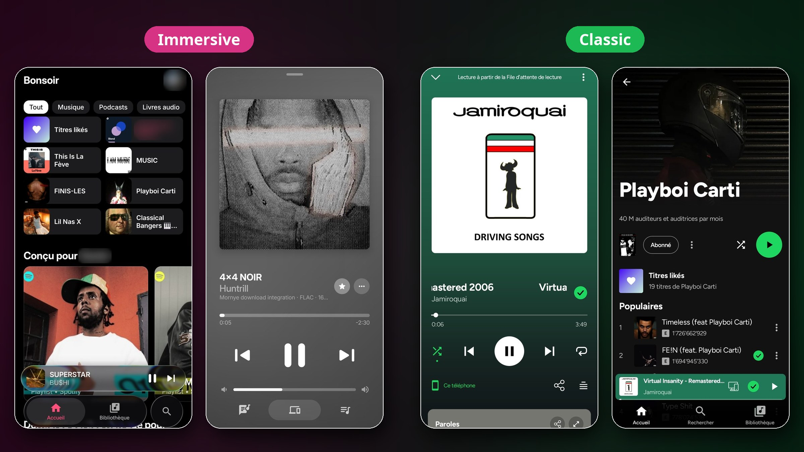
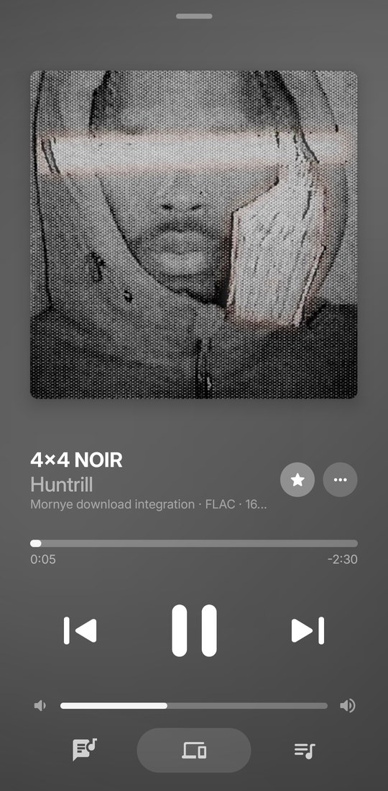
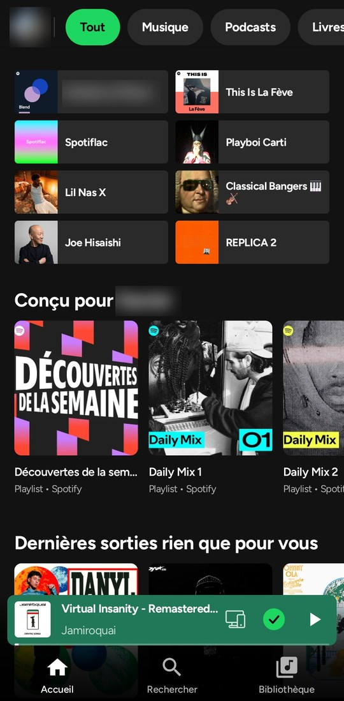
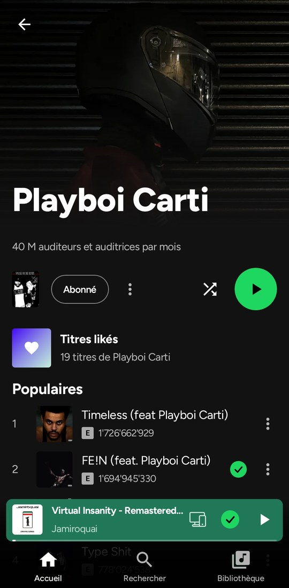

Spoon

[](https://github.com/prakha194/Spotify/releases/latest)
[](LICENSE)
[](https://github.com/prakha194/Spotify/stargazers)

**A free, open-source music player for Android, Android TV and Wear OS that plays through your own Spotify account.**

No ads added by the app, no tracking, nothing sent to the developer. A free Spotify account is enough.

> [!NOTE]
> Spoon is released under GPL-3.0 and maintained by Prashant. 😎 — see [Credits](#credits). Spoon is not affiliated with Spotify.

<p align="center">
  
</p>

<p align="center">
  <a href="https://github.com/prakha194/Spotify/releases/latest"><b>⬇ Download the latest release</b></a>
</p>

<p align="center">
  <a href="https://prakha194.github.io/buy-me-a-coffee/"></a>
  <a href="https://github.com/sponsors/prakha194"></a>
</p>

---

## How it works

You sign in on Spotify's own login page, so the app never sees your password. Behind the scenes, Spotify's official Web Player plays the music in a hidden view, using your phone's DRM. Spoon draws its own native screens on top and controls it.

Because playback goes through Spotify's own player, your plays are reported to Spotify just like in a browser. They count for the artists, in your listening history and in your Wrapped.

## Features

**Listening**
- Home, Search, Browse, New releases, Your Library (with folders), and artist, album, playlist and profile pages
- Shuffle, Smart Shuffle, repeat modes, crossfade, sleep timer and a drag-to-reorder queue
- Podcasts and audiobooks with their own player (speed, ±15 s skip, mark as played)
- Spotify Connect, Jam, Bluetooth, lock screen, notification, home-screen widget and Android Auto
- 10-band equalizer, playback speed and "Stats for nerds" for downloaded, local and extension songs

**Lyrics**
- Synced lyrics, word by word or line by line, with translation
- Song meanings from Genius

**Playlists**
- Create, edit, sort, and make playlists public, private or collaborative
- Add songs from an in-playlist search with suggestions
- Share anything as a link or a scannable Spotify Code

**Offline and local**
- Offline downloads through a download-source extension you install (encrypted on your phone)
- Downloaded playlists stay in sync with Spotify
- Plays your own local audio files

**Extensions**
- Sandboxed community scripts: extra lyrics sources, audio and download sources, Home sections and tools
- Before installing, you see every permission an extension asks for and why
- [User guide](docs/extensions/GUIDE.md) · [API for authors](docs/extensions/API.md)

**And more**
- Two looks: Classic and Immersive, switched in Settings → Display
- A private listening recap that stays on your phone
- Optional Live Radio from the [Radio Browser](https://www.radio-browser.info) directory
- 69 languages, data saver, battery saver, AMOLED black and accent colours

## Install

1. Download the APK from the [latest release](https://github.com/prakha194/Spotify/releases/latest). Android 10 or later is required.
2. Open it. Android asks once to allow installs from your browser or file manager.
3. Tap **Log in with Spotify**, sign in, pick your sound quality, and you're in.

Each release carries:

| File | For |
|---|---|
| `Spoon-<version>-universal.apk` | Every phone: 64-bit and 32-bit in one file. **Pick this one.** |
| `Spoon-<version>-ARMv8.apk` | Most phones from the last ten years (64-bit), when a smaller file is published |
| `Spoon-<version>-ARMv7.apk` | Older or entry-level 32-bit phones |
| `Spoon-<version>-TV.apk` | Android TV and Google TV |

Every APK has a matching `.sha256` file if you want to check the download.

**Updating:** Spoon tells you when a newer release is out — a card with **Update now** (opens the release page) and **Not now**. Because each build is signed, installing a new APK over an old one works only when both carry the same key; if Android refuses, uninstall the old Spoon first (your Spotify account and library are not affected).

**Coming from Myspoti or Orpheon?** Those are separate apps (`app.myspoti`, `app.orpheon`), so Spoon installs next to them. Uninstall the old one when you no longer need it.

## Screenshots

Two looks, switched in Settings → Display.

**Immersive**

| Home | Player |
|:---:|:---:|
|  |  |

**Classic**

| Home | Player | Artist | Album |
|:---:|:---:|:---:|:---:|
|  |  |  |  |

## Privacy

- **Spotify** receives your plays, as with any Spotify client.
- **Lyrics sites, Genius and Google Translate** are queried for lyrics, song meanings and translations.
- **Extensions** contact only the hosts they list, shown to you before you install them.
- **Live Radio**, if you turn it on, queries Radio Browser and each station's own server.
- **Nothing is sent to the developer.**

## FAQ

**Is it safe for my account?**
Spoon talks to Spotify the same way the Web Player does, and you sign in on Spotify's own page. Ads play as Spotify sends them. See the [disclaimer](#disclaimer).

**Spotify refused to play a song. What can I do?**
Some new or free accounts are refused by Spotify. Open Settings → **Export a diagnostic report** and attach it to a [GitHub issue](https://github.com/prakha194/Spotify/issues). The report holds the app's recent log and your phone model — never your password or login tokens.

**Do downloaded songs count in my Wrapped?**
No. Downloaded songs play from your phone and aren't reported to Spotify. They still count in Spoon's own recap. Streamed songs count as usual.

**Does Spoon download Spotify audio?**
No. There's no DRM circumvention. Offline files come only from a download-source extension you choose to install.

**Why is Home empty?**
Home is Spotify's own feed. It fills once you are signed in and have listened to a few things; a brand-new account can stay empty for a while. Search, Your Library and artist pages work right away.

## Building from source

The Android project is in [`base/`](base). You need JDK 17+ and the Android SDK (compileSdk 37).

```bash
cd base
./gradlew assembleDebug          # debug build
./gradlew testDebugUnitTest      # unit tests
```

Release APK (signed with the key in `base/keystore/keystore.properties`):

```bash
cd base
./gradlew assembleRelease -PappVersionName=1.0.9 -PappVersionCode=109 \
  -Pabis=arm64-v8a,armeabi-v7a
```

The APK ends up in `base/app/build/outputs/apk/release/`.

Every push to `main` is built by GitHub Actions (`.github/workflows/build-apk.yml`); the APK is attached to the run as the `spoon-apk` artifact. A `vX.Y.Z` tag publishes it as a GitHub Release.

### Project layout

| Module | What it does |
|---|---|
| `:api` | Plain Kotlin models and interfaces the UI talks to |
| `:api-spotify` | That API implemented on Spotify's Web Player |
| `:host-cdp` | The bridge that drives the hidden Web Player |
| `:api-web`, `:api-ytmusic` | Optional account providers (hidden pages, YouTube Music) |
| `:catalog` | Search and item pages from public metadata providers (Deezer, iTunes, MusicBrainz) |
| `:host-android` | Playback service, media session, notification, Android Auto browsing |
| `:engine`, `:engine-android` | The native playback core |
| `:extensions`, `:extensions-cli` | The sandbox third-party scripts run in, and its desktop runner |
| `:automix`, `:pass`, `:wear` | AutoMix, moving settings to another device, Wear OS |
| `:app` | The Compose UI, in its Classic and Immersive looks |

## Support

Spoon is free and made in spare time. If you enjoy it, you can [buy me a coffee](https://prakha194.github.io/buy-me-a-coffee/) or [sponsor on GitHub](https://github.com/sponsors/prakha194), also from **About** in the app. Nothing is locked behind a donation.

Bugs and requests: [GitHub issues](https://github.com/prakha194/Spotify/issues).

## Credits

**Myspoti / Orpheon.** Spoon is based on [Myspoti](https://github.com/kota-zo/myspoti) (later renamed Orpheon) by [kota-zo](https://github.com/kota-zo) and its contributors, under GPL-3.0.

**BitChord.** The Immersive look and the equalizer come from [BitChord](https://github.com/kushagrasinghx/BitChord) by kushagrasinghx and contributors (GPL-3.0-or-later).

**Others**
- UI etc. are based on other open source projects, which falls under fair license use.

Full notices: [`THIRD_PARTY_NOTICES.md`](THIRD_PARTY_NOTICES.md).

## Disclaimer

Spoon is not affiliated with Spotify or with any streaming service or content provider. You sign in with your own account and use the app at your own risk. The maintainer is not liable for any misuse of the app or of the extensions installed in it. If you can, support the artists you listen to by subscribing or buying their music.

## License

GPL-3.0. If you reuse this code you must credit Spoon and keep the licence notices, and publish your complete source under GPL-3.0. Closed-source or uncredited copies are violations of the licence.
